# Pocket Paws 🐾

Cute pixel animals that sit beside your Mac pointer, take tiny footsteps when you
move, react to clicks, and nap when you're idle.

**12 animals · Apple Silicon & Intel · macOS 13+ · open source**

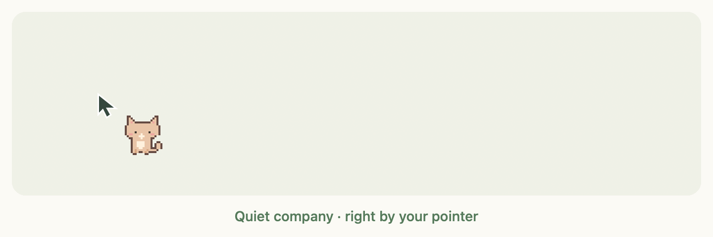

## Install

### Clone and install locally

Building on your own Mac normally avoids the verification warning shown for the
downloaded prototype. You need **Swift 6+ / Xcode 16+ command-line tools**.

If you don't have Apple's developer tools, run this first and finish the installer:

```sh
xcode-select --install
```

Then run these commands in Terminal:

```sh
git clone https://github.com/NakulKhanna2001/pocket-paws.git
cd pocket-paws
bash scripts/install.sh
```

This builds the app, installs it in **`~/Applications`**, and opens it. Look for the
**paw icon in your menu bar**. No paid Apple Developer account is needed.

If the script reports an older Swift version, update your developer tools.

### Or download the app

1. Download **Pocket-Paws-macOS.zip** from [Releases](https://github.com/NakulKhanna2001/pocket-paws/releases).
2. Unzip it and drag **Pocket Paws.app** into **Applications**.
3. Open it and click the paw icon in the menu bar.

The current prototype isn't notarized by Apple. If macOS blocks it, try opening it
once, then go to **System Settings → Privacy & Security → Open Anyway**.

## Use it

Click the paw icon to choose an animal, change its size, preview footsteps, or
customize reactions. Your choices save automatically.

| What you do | What your friend does |
| --- | --- |
| Move the pointer | Takes small, front-facing steps beside it |
| Left click | Paw tap |
| Right click | Wink |
| Hold, then release | Crouch, then hop |
| Drag | Carry a tiny box |
| Stay idle | Take a nap |

The animal stays beside your pointer—there's no chasing or delayed catch-up.
Turn on **Calmer animations** for still poses, or use the main switch to pause it.

## Meet the animals

| Picture | Name | Animal | Picture | Name | Animal |
| :---: | --- | --- | :---: | --- | --- |
| 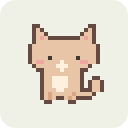 | Mochi | Cat | 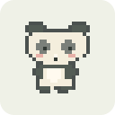 | Bao | Panda |
| 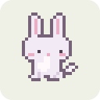 | Clover | Bunny | 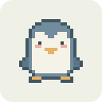 | Pengu | Penguin |
| 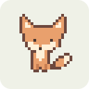 | Ember | Fox | 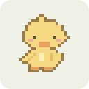 | Sunny | Duck |
| 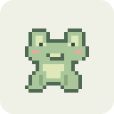 | Puddle | Frog | 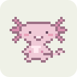 | Boba | Axolotl |
| 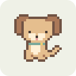 | Biscuit | Puppy | 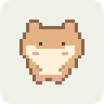 | Nibble | Hamster |
| 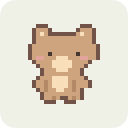 | Honey | Bear | 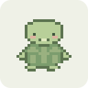 | Sprout | Turtle |

## Update or remove

If you installed from a clone, run this inside the `pocket-paws` folder:

```sh
git pull --ff-only
bash scripts/install.sh
```

For a downloaded copy, quit the app and replace it with the newer download.
To uninstall, choose **Quit** in the paw menu and move the app to the Trash.

## Make it your own

Fork the repository to add animals or change the behavior. The code and original
artwork are [MIT licensed](LICENSE). See the [developer guide](docs/DEVELOPMENT.md)
for building, adding animals, running checks, and signing releases.

Pocket Paws is a companion beside the normal cursor. It doesn't record your screen,
capture typed text, or use the network.
