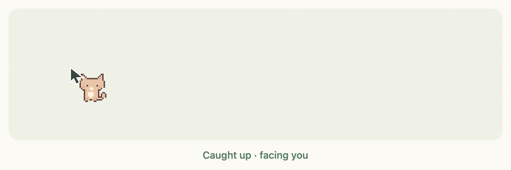
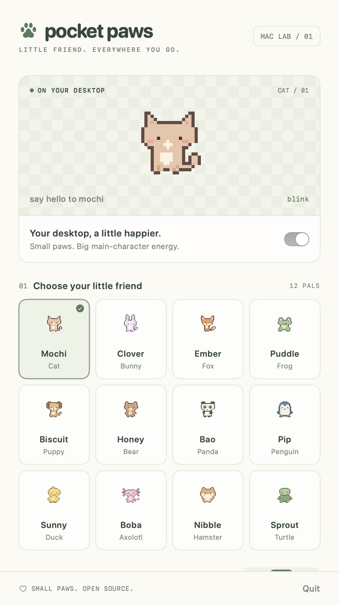

# Pocket Paws 🐾

Tiny pixel animals that chase your Mac cursor. Move your mouse and your friend
turns sideways and trots toward it. Stop, and they catch up, turn to face you,
and eventually settle down for a nap.

**12 animals · customizable reactions · native macOS · MIT licensed**



## Install on a Mac

### Download the app — easiest, about a minute

1. Open [Releases](https://github.com/NakulKhanna2001/pocket-paws/releases).
2. Download **Pocket-Paws-macOS.zip** from the latest release and unzip it.
3. Drag **Pocket Paws.app** into **Applications**.
4. Open it. Look for the **paw icon in the menu bar**, rather than the Dock.

Requires **macOS 13 Ventura or later**. Universal release builds contain both
**Apple Silicon (M-series)** and **Intel** executables. No developer tools are
needed to run a downloaded app.

**Current release signing:** these prototype builds are ad-hoc signed, not Apple
notarized. On a downloaded build, macOS may block the first launch. After trying
to open the app, use **System Settings → Privacy & Security → Open Anyway** for
Pocket Paws, then confirm Open. This is a one-time approval for this app; do not
disable Gatekeeper globally. Managed work/school Macs may require IT approval.

A future Developer ID-signed, notarized release can use the normal download,
drag, and open flow without this extra approval.

### Build your own fork — developer route

Requires **Swift 6+** and **Xcode 16+ command-line tools**. No third-party dependencies.
If needed, install Apple's command-line tools with `xcode-select --install`, then
check `swift --version` reports Swift 6 or newer.

```sh
git clone https://github.com/NakulKhanna2001/pocket-paws.git
cd pocket-paws
swift run PawsChecks
bash scripts/build-app.sh
open "dist/Pocket Paws.app"
```

To keep it in your personal Applications folder:

```sh
mkdir -p "$HOME/Applications"
ditto "dist/Pocket Paws.app" "$HOME/Applications/Pocket Paws.app"
open "$HOME/Applications/Pocket Paws.app"
```

The first build can take a few minutes. A local build uses your Mac's architecture
by default. Build both architectures with `UNIVERSAL=1 bash scripts/build-app.sh`.

## Choose your friend

Click the **paw icon** in the menu bar, then click an animal. Scroll within the
panel for the size controls, **Preview walk**, gesture mappings, and preferences.
Your choices save automatically.

| Friend | Animal | Friend | Animal |
| --- | --- | --- | --- |
| Mochi | Cat | Bao | Panda |
| Clover | Bunny | Pengu | Penguin |
| Ember | Fox | Sunny | Duck |
| Puddle | Frog | Boba | Axolotl |
| Biscuit | Puppy | Nibble | Hamster |
| Honey | Bear | Sprout | Turtle |



## How it behaves

| Input | Default reaction |
| --- | --- |
| Move your pointer | Chase it in a left- or right-facing side profile |
| Stop moving | Catch up, stop near the pointer, and face forward |
| Left click | Paw tap |
| Right click | Wink and a heart |
| Hold left click for 0.45 seconds | Crouch |
| Release after holding | Happy hop |
| Drag at least 4 points | Carry a tiny box |
| Idle for 6 seconds | Nap |

The animal has its **own position**, so it trails behind and slows down as it
approaches. It faces the cursor's location, rather than copying the last mouse
movement. It keeps walking while catching up even after the pointer stops.
Click/hold reactions take priority over the walking pose.

Left click, right click, hold, and drag can each be mapped to different reactions.
Three sizes, idle naps, and calmer animations are available. Calmer animations
and macOS Reduce Motion use immediate, still following instead of a delayed chase.

**Prototype scope:** this is a click-through desktop companion alongside the native
pointer, not a replacement for the system cursor. It is configured to join Spaces
and full-screen apps; secure system surfaces or exclusive full-screen apps may
suppress third-party overlays. Long press is not a pressure-sensitive Force Click,
and the app does not detect every application's “thinking/loading” state.

## Pause, update, or uninstall

- **Pause:** turn off the switch in the menu-bar panel. This stops tracking too.
- **Quit:** click **Quit** at the bottom of the panel.
- **Update:** quit the app, replace it with the newer copy, and reopen it.
- **Uninstall:** quit and move Pocket Paws.app to the Trash. Preferences are stored
  under `dev.pocketpaws.mac`; optionally remove them with `defaults delete dev.pocketpaws.mac`.

The app does not register itself to launch at login. You can add it using macOS
System Settings → General → Login Items if you want it to start automatically.

## Privacy and permissions

Pocket Paws uses public AppKit APIs to read mouse position/button state and observe
mouse-down events. It does not record the screen, capture typed text, or use the
network. No Accessibility permission prompt is requested. The overlay ignores
mouse events and does not take keyboard focus.

## Fork and add an animal

The code **and original pixel art** are MIT licensed. Fork this repository and:

1. Copy a JSON file in `Sources/PawsCore/Animals/` and give it a unique `id`.
2. Set the name, species, personality, and six-digit RGB `accent`.
3. Draw `pixels`: a front-facing rectangular sprite, 8–48 pixels per side.
   `.` means transparent. Add each other character to `palette` with an RGB hex
   color without `#`. Reserve `o` for outline, `b` for body, and `e` for eyes.
4. Set `eyeRow` and the two `eyeColumns` to the zero-based front-facing `e` pixels.
5. Draw `sidePixels`: a **right-facing** profile with the same dimensions and palette.
   The renderer mirrors it when chasing left. Two separated groups on the bottom
   occupied row identify the feet for the shared six-frame walking cycle.
6. Update the expected animal count in `Tests/PawsChecks/main.swift`, run
   `swift run PawsChecks`, and rebuild.

Files are discovered automatically, sorted by filename. The `sidePixels` field is
optional for older packs, which fall back to their front sprite when walking.
For a distributed fork, change `CFBundleIdentifier` in `Resources/Info.plist` to
your own reverse-DNS identifier.

## Development

```text
Sources/PawsCore/          Animal schema, gesture state machine, cursor chase physics
Sources/PawsCore/Animals/  Front and side pixel-art JSON
Sources/PocketPaws/        AppKit overlay, SwiftUI menu-bar controls, renderer
Tests/PawsChecks/          Gesture, chase, asset, and multi-display checks
Resources/Info.plist       macOS app metadata
scripts/build-app.sh      App bundle, icon generation, signing, release ZIP
```

Position updates run at 60 Hz; pixel-art animation runs at 8 fps. The follower is
time-based and keeps the pet within its display. Moving to another display starts
the pet nearby instead of chasing through gaps between monitors.

```sh
swift run PawsChecks
swift run PocketPaws --smoke-test
swift run PocketPaws --render-preview /absolute/path/preview.png
swift run PocketPaws --export-walk-preview /absolute/path/walking.gif
swift run PocketPaws --export-chase-preview /absolute/path/chasing.gif
```

The smoke test launches and exits the real AppKit app. Preview commands render the
actual art/follower without recording your desktop. Before releasing, also check
your mouse, display layouts, Spaces, and preferred full-screen apps interactively.

## Signing a public release

The build script creates `dist/Pocket Paws.app` and `dist/Pocket-Paws-macOS.zip`.
For a Developer ID-signed and notarized release, with your certificate and notary
profile already configured:

```sh
UNIVERSAL=1 SIGN_IDENTITY="Developer ID Application: Your Name (TEAMID)" bash scripts/build-app.sh
xcrun notarytool submit dist/Pocket-Paws-macOS.zip --keychain-profile YOUR_PROFILE --wait
xcrun stapler staple "dist/Pocket Paws.app"
ditto -c -k --sequesterRsrc --keepParent "dist/Pocket Paws.app" dist/Pocket-Paws-macOS.zip
```

The GitHub Actions workflow runs the checks and builds an ad-hoc-signed universal
ZIP. It does not automatically notarize or publish releases.
