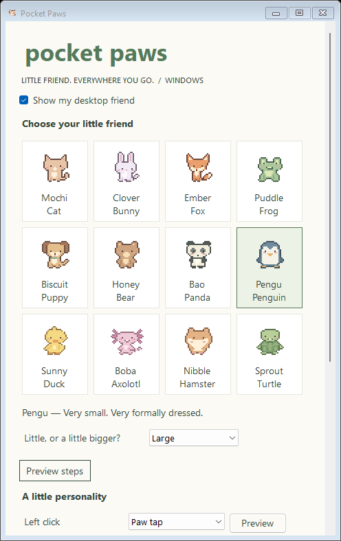

# Pocket Paws for Windows

A native Windows tray app with the same 12 animals and front-facing footsteps as
the Mac version. The animal sits right beside the pointer and reacts to clicks,
holds, and dragging.

## Use the preview

Requires **64-bit Windows 10 or Windows 11**. The default download is for x64 PCs.

1. Download **Pocket-Paws-Windows-win-x64.zip** from the [Windows preview release](https://github.com/NakulKhanna2001/pocket-paws/releases/tag/windows-v0.1.1).
2. Extract the ZIP into a folder you want to keep.
3. Double-click **PocketPaws.exe**.
4. Click the **animal icon in the system tray**, near the clock, to choose a friend.
   If it is hidden, click the **^** tray overflow arrow.

The portable download includes the .NET runtime. Users do not need developer
tools, .NET installation, or administrator access. This initial preview is unsigned,
so Windows may show a SmartScreen prompt on downloaded copies.

Use the picker to change animals, size, reactions, naps, and calmer animations.
Right-click the tray icon for pause/resume and quit. Closing the picker keeps the
companion running; choose **Quit Pocket Paws** to exit completely.



The picker above was rendered by the Windows CI launch check. Controls follow
the Windows theme on your computer.

## Build from a clone

Install the **.NET 10 SDK** and Git, then run in PowerShell:

```powershell
git clone https://github.com/NakulKhanna2001/pocket-paws.git
cd pocket-paws
dotnet run --project windows/PocketPaws.Checks -c Release
dotnet publish windows/PocketPaws.Windows -c Release -r win-x64 --self-contained true -p:PublishSingleFile=true -p:IncludeNativeLibrariesForSelfExtract=true -o dist/windows/win-x64
.\dist\windows\win-x64\PocketPaws.exe
```

The optional `scripts/build-windows.ps1` packages a compressed executable, ZIP,
and checksum. It also accepts `-Runtime win-arm64` for an ARM64 build. ARM64 builds
need testing on an ARM Windows machine; CI currently runs the x64 app.

## Settings and updates

Settings are saved in `%LOCALAPPDATA%\PocketPaws\settings.json`.
To update, quit the app from the tray and replace the executable with the newer
copy. To uninstall, quit and delete its folder; optionally delete the settings
folder too. The app does not register itself to run at startup.

The overlay is click-through, does not take keyboard focus, and accounts for
display scaling and secondary monitors. It pauses when the Windows session locks
or the computer sleeps. It reads mouse position and button state, with a mouse-only
hook for brief clicks; it does not capture typed text, record the screen, or use
the network. Secure desktops and exclusive full-screen apps can suppress overlays.

## Development

- `windows/PocketPaws.Core`: platform-independent gestures, sprite rasterizer,
  and screen placement. Animal JSON is embedded directly from the shared
  `Sources/PawsCore/Animals` folder; no separate Windows copies are maintained.
- `windows/PocketPaws.Windows`: WinForms picker, tray, click-through overlay,
  native input monitoring, and local preferences.
- `windows/PocketPaws.Checks`: dependency-free behavior and rendering checks.

The GitHub **Build Windows app** workflow runs the checks, builds the portable ZIP,
and launches the real Windows app for an isolated smoke test of its tray, overlay,
portraits, saved settings, pause, and resume. Before a broader release, also test
interactively with real mice, mixed-DPI displays, full-screen apps, and Windows
virtual desktops.
